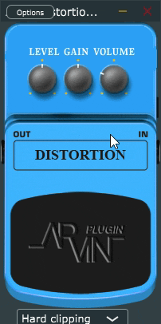

# Arvin Distortion Pedal



*Created by **Fajar Julyana** | **QWare.id***

[](LICENSE)
[](https://juce.com/)
[]()
[]()

**Arvin Distortion Pedal** menyajikan karakter distorsi analog responsif bernuansa presisi. Built using **JUCE 7.0.9**, this audio plugin emulates versatile saturation and waveshaping modes alongside an active tone filter, input/output gain staging, and ASIO support.

---

## Key Features

* **5 Distortion Modes**:
  * **Hard Clipping**: Asymmetrical clipping providing rich even harmonics and aggressive overdrive.
  * **Soft Clipping**: Cubic polynomial waveshaper for tube-like warmth and natural compression.
  * **Exponential**: Mathematical curve saturation.
  * **Full-Wave Rectifier**: Octave-up style frequency multiplication.
  * **Half-Wave Rectifier**: Asymmetrical pulse-shaping distortion.
* **Active Tone Shaping**: Integrated IIR filter for controlling high-end brightness.
* **Gain Staging**: Independent Input Gain (-24 dB to +36 dB) and Output Gain (-24 dB to +24 dB) controls.
* **Multi-Platform Support**: Ready for Windows, macOS, and Linux.
* **ASIO Driver Support**: Direct low-latency driver support for Windows Standalone mode.
* **Custom GUI**: Custom pedal layout featuring embedded asset resources and custom LookAndFeel rotary knobs.

---

## Controls & Parameters

| Parameter | Type | Range | Description |
| :--- | :--- | :--- | :--- |
| **Distortion Type** | ComboBox | 5 Modes | Switches between Hard, Soft, Exponential, Full-Wave, and Half-Wave modes. |
| **Input Gain** | Rotary Slider | -24 dB to +36 dB | Adjusts the incoming signal drive level. |
| **Tone** | Rotary Slider | -24 dB to +24 dB | Controls the cutoff filter response. |
| **Output Gain** | Rotary Slider | -24 dB to +24 dB | Sets final output volume to manage headroom. |

---

## Multi-Platform Build & Exporters

The project is pre-configured in `ArvinDistortionPedal.jucer` using **JUCE 7.0.9** for cross-platform target builds:

| Platform | Exporter | Targets Supported |
| :--- | :--- | :--- |
| **Windows** | Visual Studio 2019 / 2022 | VST3, LV2, Standalone Executable |
| **macOS** | Xcode (`XCODE_MAC`) | VST3, LV2, Standalone App |
| **Linux** | Linux Makefile (`LINUX_MAKE`) | VST3, LV2, Standalone Binary |

### Building Instructions

1. **Clone the Repository:**
   ```bash
   git clone https://github.com/fajarjulyana/ArvinDistortion.git
   cd ArvinDistortion
   ```

2. **Open Project in Projucer (JUCE 7.0.9):**
   * Load `ArvinDistortionPedal.jucer`.
   * For Windows ASIO support, ensure `ASIO SDK` is pointing to your local path (e.g., `C:\ASIOSDK\common`).

3. **Compile via your OS Exporter:**
   * **Windows**: Open the generated Visual Studio solution in `Builds/VisualStudio2019`. *Run Visual Studio as Administrator if post-build auto-copy to `C:\Program Files\Common Files\VST3\` is enabled.*
   * **macOS**: Open `Builds/MacOSX/ArvinDistortionPedal.xcodeproj` in Xcode and build target `Release`.
   * **Linux**: Navigate to `Builds/LinuxMakefile` and run:
     ```bash
     make CONFIG=Release
     ```

---

##  File Structure

```text
ArvinDistortionPedal/
├── Capture/
│   └── capture.gif                # Preview GIF demo by Fajar Julyana
├── Source/
│   ├── assets/                    # Embedded PNG textures & knobs
│   ├── PluginProcessor.h          # Audio DSP and parameter declarations
│   ├── PluginProcessor.cpp        # Audio buffer manipulation & clipping algorithms
│   ├── PluginEditor.h             # GUI layout & LookAndFeel class definitions
│   ├── PluginEditor.cpp           # Custom LookAndFeel knob rendering & UI elements
│   └── PluginParameter.h          # APVTS parameter wrapper helper classes
├── ArvinDistortionPedal.jucer     # Projucer Project Configuration File (JUCE 7.0.9)
├── LICENSE                        # MIT License
└── README.md
```

---

##  License

This project is licensed under the **MIT License** - see the [LICENSE](LICENSE) file for details.

```text
Copyright (c) 2026 Fajar Julyana (QWare.id)
```

---

##  Author & Contact

* **Developer**: Fajar Julyana
* **Company / Organization**: QWare.id
* **Website**: [fajarjulyana.github.io](https://fajarjulyana.github.io)
* **Email**: [fajarjulyana1@gmail.com](mailto:fajarjulyana1@gmail.com)
